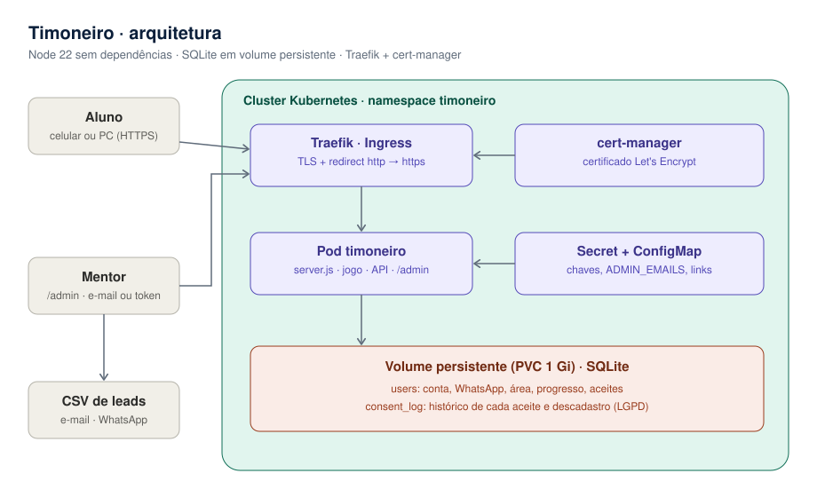

# ☸ Timoneiro — Lab Kubernetes da mentoria

Jogo para aprender Kubernetes navegando por ilhas, tempestades e plantões, com conceitos e comandos baseados na documentação oficial.
Criado por **Eduardo Lorente de Oliveira** · [LinkedIn](https://www.linkedin.com/in/eduardo-lorente-de-oliveira-24201916) · [Instagram @lorente.cloud](https://www.instagram.com/lorente.cloud/) · [GitHub](https://github.com/eoliveiralorente)

## Arquitetura



- **Sem dependências:** Node 22 puro, com SQLite embutido (`node:sqlite`). Não precisa de `npm install`.
- **Uma imagem, um volume:** 1 réplica (estratégia `Recreate`) e um PVC de 1 Gi.
- **Entrada:** Traefik com TLS do cert-manager (Let's Encrypt) e redirecionamento de `http` para `https`.
- **Configuração:** links e textos no ConfigMap `timoneiro-config`; chaves e e-mails de administrador no Secret `timoneiro-secrets`.

## Rotas

| Rota | Para quê |
|---|---|
| `/` | O jogo (Ilha 00 grátis como convidado; conta a partir da Ilha 01) |
| `/admin` | Painel do mentor (login com e-mail de administrador ou `ADMIN_TOKEN`) |
| `/privacidade` | Termos e Política de Privacidade (**modelo: preencha e revise com um advogado**) |
| `/api/unsubscribe?k=…` | Link de descadastro de e-mail de cada aluno (vai no CSV de leads) |
| `/healthz` | Health check |

## Funcionalidades

**Aluno**
- Joga a Ilha 00 sem cadastro. Para seguir, cria a conta com nome, e-mail, senha e **WhatsApp obrigatório** (com aviso em destaque); área de atuação é opcional.
- Aceites **separados e opcionais**: ofertas por e-mail e ofertas por WhatsApp.
- Em *Carreira → Sua conta*: editar WhatsApp e área, ligar/desligar cada aceite, baixar os próprios dados, trocar senha e excluir a conta.

**Mentor (`/admin`)**
- Alunos ativos, em risco (5+ dias parados), engajados e com rota completa; filtro por área (SRE, DevOps, PO/PM…).
- Botão **WhatsApp** com mensagem pronta e **Parar WhatsApp** para registrar descadastro.
- CSV de leads de **e-mail** (com link de descadastro) e de **WhatsApp** (com link `wa.me`), cada um só com quem deu aquele aceite.
- Senha temporária para aluno que esqueceu a dele.

**Ofertas no jogo** (aparecem se `MENTORIA_URL` e `LOJA_URL` estiverem definidas): mentoria após a tempestade da Ilha 04; camiseta a cada nova patente e ao completar a rota.

Cada aceite e descadastro fica registrado em `consent_log`, com texto exato, versão, data, IP e navegador.

## Rodar local

```bash
APP_SECRET="$(openssl rand -base64 48)" ADMIN_TOKEN="$(openssl rand -base64 32)" \
ADMIN_EMAILS="seu-email@dominio.com" node server.js
# abra http://localhost:8080
```

## Subir no Kubernetes

1. **Imagem:** crie uma tag; o workflow publica em `ghcr.io/<usuario>/timoneiro:<versão>`.
   ```bash
   git tag v1.3.0 && git push origin v1.3.0
   ```
   Deixe o pacote público no GHCR ou crie um `imagePullSecret`.
2. **Ajustar** `k8s/10-config.yaml` (`PUBLIC_URL`, links, e-mail) e o host em `k8s/50-ingress.yaml`.
3. **Namespace e Secret** (fora do Git):
   ```bash
   kubectl apply -f k8s/00-namespace.yaml
   kubectl -n timoneiro create secret generic timoneiro-secrets \
     --from-literal=APP_SECRET="$(openssl rand -base64 48)" \
     --from-literal=ADMIN_TOKEN="$(openssl rand -base64 32)" \
     --from-literal=ADMIN_EMAILS="seu-email@dominio.com"
   ```
   Crie sua conta no jogo com esse e-mail **antes** de divulgar o link.
4. **Aplicar:** `kubectl apply -k k8s/` (ou use `k8s/argocd-application.yaml` com ArgoCD).
5. **HTTPS:** o Ingress usa `cert-manager.io/cluster-issuer: letsencrypt` e o Middleware `redirect-https` do Traefik.

## Publicar uma versão nova

```bash
git add -A && git commit -m "..." && git push
git tag vX.Y.Z && git push origin vX.Y.Z          # esperar a Action ficar verde
sed -i -E 's#timoneiro:[0-9]+\.[0-9]+\.[0-9]+#timoneiro:X.Y.Z#' k8s/30-deployment.yaml
git commit -am "deploy vX.Y.Z" && git push
kubectl apply -k k8s/ && kubectl -n timoneiro rollout status deploy/timoneiro
```

## Antes de abrir para o público

- [ ] Preencher os campos `[entre colchetes]` de `public/privacidade.html` e revisar com um advogado.
- [ ] Ativar backup: `kubectl apply -f k8s/backup-cronjob.yaml` e copiar `/data/backups` para fora do cluster.
- [ ] Enviar promoções só para quem tem o aceite correspondente (use os filtros e CSVs do painel).

## Limites conhecidos

- E-mail e WhatsApp não são confirmados por código; recuperação de senha é feita pelo mentor (senha temporária).
- SQLite pede **1 réplica**. Para escalar ou ter backup contínuo, migrar para Postgres (gerenciado ou CloudNativePG) ou usar Litestream.
- O conteúdo das lições está em `public/index.html` (constante `U`), com link para a documentação oficial em cada item.
